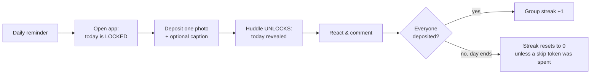
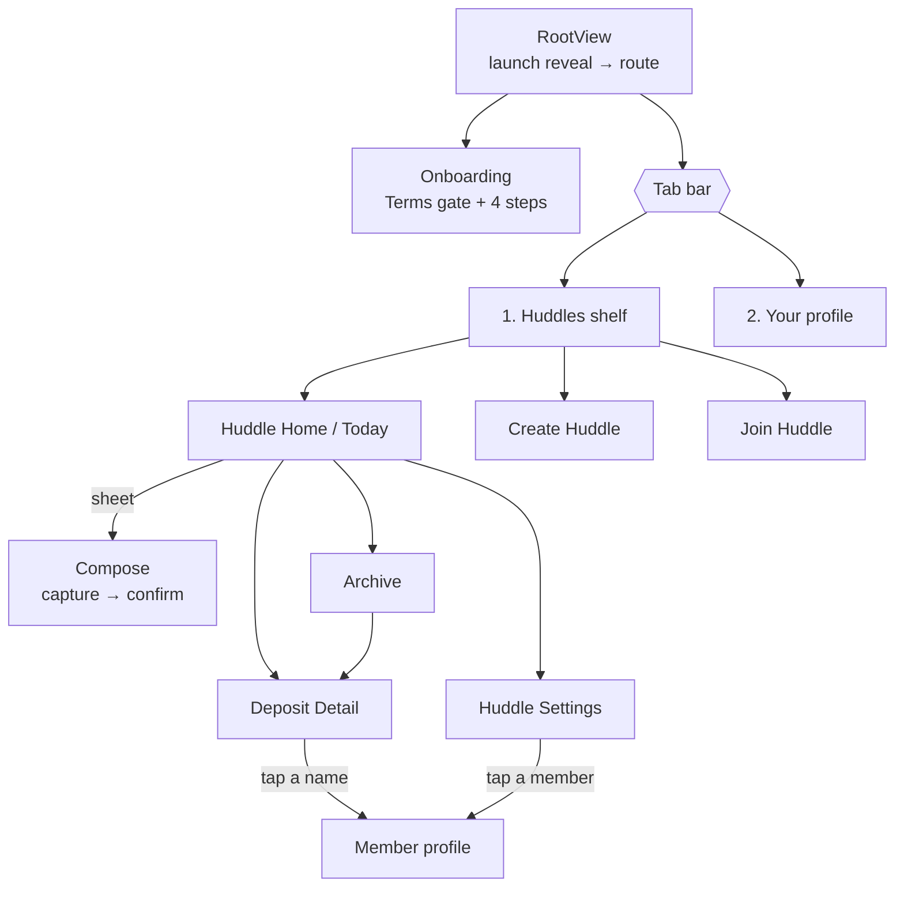
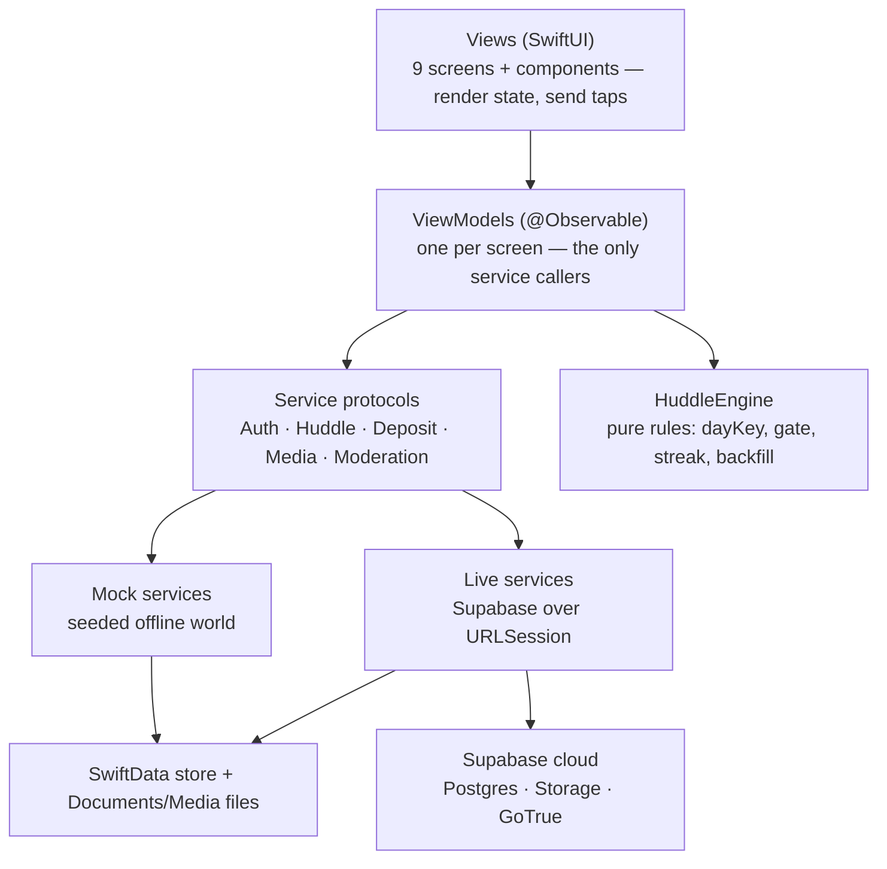
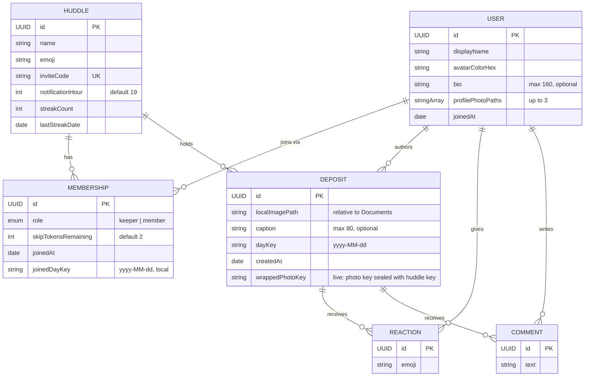
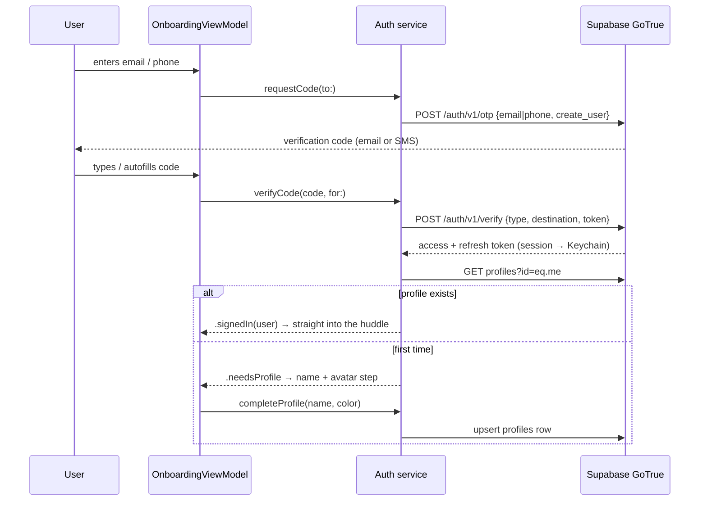
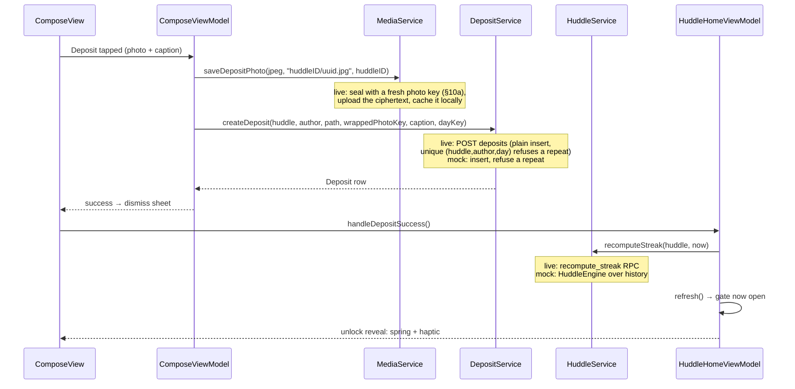
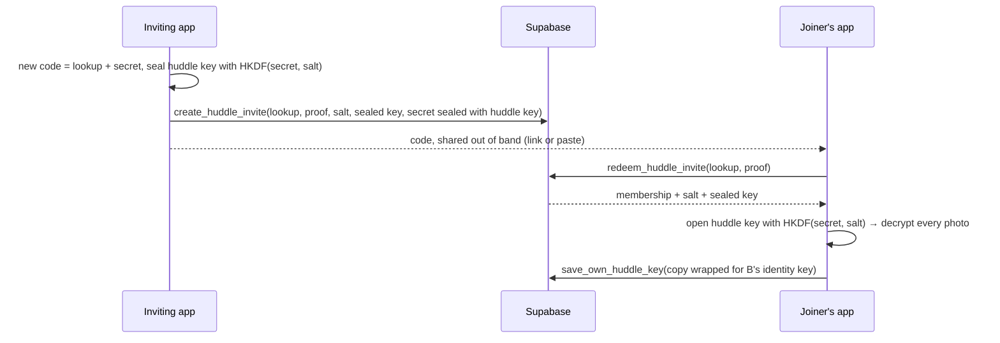

# HuddlePals — The Complete Guide

> A private, daily photo ritual for small groups. One photo per person per day. Today stays **locked** until you contribute yours. The streak belongs to the **group**. Over time, the huddle becomes the group's permanent collective archive — the opposite of Instagram: private, permanent, small, daily.

This document is the single place to understand everything: the product, the rules, the architecture, the data, the auth system, the backend, and how it all connects. Companion docs: [README.md](README.md) (quick start + file map), [DEPLOYMENT.md](DEPLOYMENT.md) (go-live runbook), [supabase/schema.sql](supabase/schema.sql) (the entire backend in one file).

| Fact | Value |
|---|---|
| Platform | iOS 17.0+, SwiftUI only, Xcode 16 |
| Persistence | SwiftData on-device; Supabase Postgres in live mode |
| Dependencies | **Zero** third-party packages — Apple frameworks + raw `URLSession` |
| State | `@Observable` (Observation framework), no Combine |
| Backends | Mock (seeded offline demo) and Live (Supabase) behind identical protocols |
| Auth | Sign in with Apple. Email + SMS codes are built but switched off (`FeatureFlags.emailAndPhoneSignInEnabled = false`) |
| Design | Adaptive "gallery print": paper + ink in light, deep charcoal + paper-white in dark; system-following with in-app override |
| Tests | Deterministic XCTests (⌘U): engine rules, critical mock flows, live sync reconciliation, profile editor |

---

## Table of contents

1. [What Huddle is](#1-what-huddle-is)
2. [The rules](#2-the-rules)
3. [The nine screens](#3-the-nine-screens)
4. [Architecture](#4-architecture)
5. [Two backends, one app](#5-two-backends-one-app)
6. [Data model](#6-data-model)
7. [Authentication](#7-authentication)
8. [Life of a deposit](#8-life-of-a-deposit)
9. [Sync model](#9-sync-model)
10. [The Supabase backend](#10-the-supabase-backend)
11. [Design system](#11-design-system)
12. [The mock world & debug tools](#12-the-mock-world--debug-tools)
13. [Testing & verification](#13-testing--verification)
14. [File map](#14-file-map)
15. [Project configuration](#15-project-configuration)
16. [Known limitations & roadmap](#16-known-limitations--roadmap)

---

## 1. What Huddle is

A huddle is a private group of up to 4 people, or up to 10 when its keeper has HuddlePals+ — and you can belong to **many huddles at once** (up to 25): one with your family, one with your best friends. Each huddle tracks its own photos, members, and streak independently. Every member deposits exactly one photo per day per huddle (or, with Plus, a video of up to 6 seconds). The hook is the **reciprocity gate**: you can see *that* your people posted today (frosted cards with their names), but not *what* — until you deposit your own. Past days stay open, like a shared album the group binds one page at a time: the most recent 30 on the free plan, every one with Plus.

The daily loop:



Design intent: under 15 seconds from notification to deposited. No infinite scroll, no public anything, no individual clout — the streak is shared, so accountability is social.

## 2. The rules

All rules live in one pure-logic file, [`HuddleEngine.swift`](HuddlePal/Engine/HuddleEngine.swift) — no UI, no database, no wall clock. Everything is injected (calendar, `now`), which is why it's fully unit-tested and why the debug "advance mock day" feature works.

**dayKey.** Every deposit is stamped with the calendar day in the device's timezone, formatted `"yyyy-MM-dd"`. Lexicographic order equals chronological order. A photo at 23:59 belongs to that day; 00:01 starts a new locked day.

**Once and permanent.** One deposit per member per huddle per dayKey — a single post behind a "This is permanent — post it?" confirmation. No retakes, no edits, no deletes, ever: both backends refuse a second deposit for the same day, and the database carries no update/delete policies on deposits at all.

**The reciprocity gate.** Today is unlocked for you ⟺ a deposit exists with your author id and today's dayKey in this huddle. Nothing else opens it — not others' deposits, not yesterday's deposit. While locked, today's cards show the author's name and avatar over a frosted stand-in; the actual image bytes are deliberately never loaded. The gate only ever applies to *today*.

**The group streak.** A day *counts* when every member it waits on either deposited or spent a **skip token** (each member starts with 2). A day waits on the current members who joined *before* it. Your join day is free: you can post, and that unlocks the feed, but the group's day doesn't depend on you. So joining never breaks a streak, and you count from the next day on. (A brand-new huddle's creation day is everyone's join day, so the first day that can count is the day after.) The count is the number of consecutive counting days, walking backward from today — or from yesterday if today isn't complete yet, because an in-progress day must never break the streak. The first incomplete *ended* day stops the walk.

Worked example (the seeded world, streak = 6):

| Day | −8 | −7 | −6 … −1 | today |
|---|---|---|---|---|
| Everyone in? | ✅ | ❌ Maya missed, no token | ✅ ×6 | 3 of 4 (you haven't posted) |
| Streak | — | reset to 0 | 1…6 | still 6 — today is in progress |

A subtle consequence, verified by test: if yesterday broke the streak but *today* is already complete, the streak is 1 — a new chain starts immediately.

**The recovery window.** When a day ends incomplete, the streak reads 0 — but it isn't dead yet. A 24-hour window runs until the end of the following day (brokenDayStart + 48h): the huddle's home screen shows a live countdown and who's missing, and if those members backfill the broken day in time, the next recompute restores the full streak. When the window closes, backfill becomes impossible and the reset is permanent. (`HuddleEngine.recovery(...)`, covered by four dedicated tests.)

**Backfill.** A past day can receive a deposit within 48 hours of that day's start — in practice, yesterday. Surfaced in the Archive and by the recovery banner.

**Invite codes.** 32 characters from `ABCDEFGHJKMNPQRSTUVWXYZ23456789` — ambiguous glyphs (0/O, 1/I/L) excluded — shown as eight groups of four. The first 6 are a lookup the server stores; the other 26 are a secret (≈128.8 bits) that in live mode unlocks the huddle's key, so whoever holds the code sees every photo the moment they join (§10a). The keeper can replace the code; the old one then stops working. Old 6-character codes are retired the first time a member opens the huddle in this build. The seeded huddle's code starts `CREW-427K`.

**Captions.** Optional, hard-capped at 80 characters (enforced in the UI field, the engine sanitizer, and the database constraint).

## 3. The screens



| Screen | What it does |
|---|---|
| **Onboarding** | Terms of Service first: the full text with Agree / Decline; Agree unlocks only after scrolling to the end. Decline returns to the first concept card, and nothing past the cards opens until Agree (re-asked whenever `TermsOfService.version` changes). Then three concept cards → sign-in method (Apple; email / phone when the feature flag is on) → verification code → profile (name + avatar ink). Returning accounts skip the profile step. |
| **Huddles shelf** | Every huddle you belong to: emoji, name, member stack, streak, lock state, "N waiting for you". Tap to step inside; create/join from the toolbar. |
| **Huddle Home (Today)** | One huddle's day. Serif huddle name, member stack, streak badge, and — when a streak just broke — the 24h recovery banner with a live countdown. LOCKED: frosted 2-column grid + "Add today's memory". UNLOCKED: vertical feed of today's cards + "waiting on…" row. |
| **Compose** (sheet) | Two stages: capture (camera-only — the camera opens immediately, no library import; a photo, or with Plus a video of up to 6 seconds; caption with live counter) → the permanence gate ("This is permanent — post it?"). Posting is irreversible; success plays the lock-opening spring + haptic. Also serves backfill/recovery for yesterday. On the free plan the picker shows "Video · Plus", which opens the paywall; it opens on Video again after a video, while you have Plus. |
| **Archive** | Full history: month headers → day rows → horizontal photo strips. Today appears only once unlocked. Pull-to-refresh. Backfill banner when eligible. On the free plan, days past the last 30 show who posted and how many, locked, without loading anything; tapping one opens the paywall. |
| **Deposit Detail** | Framed photo, caption, author, date, 5-emoji reaction row (tap toggles yours), comment thread + input bar. |
| **Create Huddle** | Name + emoji picker → the new invite code → ShareLink with a working `huddlepal://join/{code}` deep link and the code in the message (the app registers the scheme and prefills Join). Then the notification permission prompt, the first time. Once you keep 3 huddles on the free plan (10 with Plus), it says so instead, with the way to Plus. |
| **Join Huddle** | Code entry (paste, type, or arrive by link; dashes and case don't matter) with error states (not found / old code / already member / huddle full / can't join). |
| **HuddlePals+** (sheet) | The paywall, from any place the free plan holds something back (a locked archive day, Video, a 4th huddle, a closed invite) or from Profile: what Plus adds, monthly and yearly plans with price, period and trial, the renewal terms, Terms of Use / Terms / Privacy links, and Restore Purchases. Closes itself once Plus is on. |
| **Huddle Settings** | Members with roles + skip tokens, streak detail, the huddle's preferred reminder hour (stored only — notification delivery is the per-user reminder in Profile), invite code with copy and share (or, when the huddle is full or its invites are paused on the keeper's free plan, why — and Get HuddlePals+ for the keeper), **New invite code** for the keeper (confirmed), leave huddle (destructive, confirmed), and for the keeper **Delete huddle** (confirmed: everyone is removed and every photo and video in it is deleted, for everyone). |
| **Your profile** | Up to 3 profile photos (the first is your profile picture/avatar), display name, 160-char bio, curated identity color (6 solids + 2 gradients), activity-notifications toggle, daily-reminder toggle + time, light/dark appearance picker, the Plan (free or HuddlePals+, Manage subscription, Restore Purchases), sign out, **delete account** (both confirmed; with Plus it warns that Apple keeps billing until the subscription is cancelled) — and in mock mode only, the DEBUG section. Profile photos, avatar color, name, and bio stay in a local draft until the user confirms **Save Changes**. A dirty exit attempt is blocked before navigation; Keep Editing preserves the draft and Discard restores the saved state, with both actions remaining on Profile. |
| **Report / block** | Any other person's photo has a "•••" menu (Deposit Detail) with **report** — including a Former member's photo — and **block** while the author still has an account; anyone else's comment can be reported by touching and holding it; any member's profile menu offers **report** and **block/unblock**. Every report ends with a "Thanks for reporting" confirmation. Blocking hides that person's photos/comments from you (presentational only — never changes the huddle or streak). UGC safeguards for App Review (guideline 1.2). |
| **Member profile** | Opened by tapping any name or avatar anywhere: swipeable photo pager, bio, and the huddles + streaks you share with them. |

## 4. Architecture

MVVM plus a protocol-oriented service layer. The golden rule: **each layer only talks to the layer directly below it.** Views never touch services; services never touch views; the engine touches nothing.



Key decisions and why:

- **`AppDependencies` is the composition root** ([App/AppDependencies.swift](HuddlePal/App/AppDependencies.swift)). Built once in `HuddlePalApp.init`, injected via SwiftUI Environment. It owns the ModelContainer, the engine, the injectable clock (`AppDateProvider`), the observable `AppSession` (current user, blocked user ids, pending invite code, the huddle a tapped notification is about, profile-setup flag, readiness), `DebugSettings`, `AppearanceSettings`, the five services, the seeder, the per-user reminder coordinator (`deps.reminders`), and the push coordinator (`deps.push`). `makeMock()` and `makeLive(config:)` are the only two wirings.
- **The engine is value-typed.** It consumes `DepositSnapshot` structs (id, huddleID, authorID, dayKey, createdAt) — never SwiftData models — plus an injected `Calendar` and explicit `now: Date`. That's what makes the math deterministic and testable.
- **View models are `@MainActor @Observable` classes**, created by their views via `@State` and handed `deps` from the environment. SwiftUI re-renders automatically when their properties change — no manual refresh plumbing.
- **Navigation** is a typed `Route` enum over per-tab `NavigationStack` paths, owned by an `@Observable AppRouter` ([App/AppRouter.swift](HuddlePal/App/AppRouter.swift)). `@Model` classes are `Hashable` by identity, so models ride in the path directly.
- **Images are files, not database blobs.** Deposits store a path *relative to Documents* (the sandbox's absolute path changes between launches). `LocalDepositImage` resolves bytes through the media service asynchronously and reloads if the path changes.

## 5. Two backends, one app

The decision happens once, at launch, in `HuddlePalApp.init`: if a `HuddlePal/HuddlePal/Supabase.plist` with real values is bundled, `AppDependencies.makeLive(config:)` wires Supabase; otherwise `makeMock()` wires the demo world. **No view or view model knows which mode it's in** — they program against the five protocols. (`deps.isLive` exists only to gate seeding and the DEBUG section.)

| Concern | Mock | Live |
|---|---|---|
| Accounts | Identity → local user map in UserDefaults; code always `123456`; first launch auto-signs-in seeded "You" | GoTrue: Apple id_token, email/SMS OTP; session in Keychain with auto-refresh |
| Huddle CRUD | SwiftData inserts; invite lookup in-store | `create_huddle` RPC, `redeem_huddle_invite` to join (proof of the code's secret, 8-member cap, blocks) |
| Deposits | Insert-only; a second same-day deposit throws `alreadyDepositedToday` | Plain insert; the `(huddle_id, author_id, day_key)` unique constraint refuses a repeat (→ `alreadyDepositedToday`) |
| Images | JPEG to `Documents/Media/` | Huddle photos end-to-end encrypted (§10a), then insert-only upload to Storage bucket `deposits` (never overwritten) + the same ciphertext as local cache; profile photos plain JPEG |
| Streak | `HuddleEngine.computeStreak` on-device | `recompute_streak` RPC — server is the single source of truth so all phones agree |
| Skips | In-memory `SkipLedger`, seeded | `skips` table + `spend_skip_token` RPC |
| Notifications | Per-user local reminders (`ReminderCoordinator`); push permission and registration run, but nothing sends | Same reminders, plus activity pushes: `device_tokens` + database triggers → `send-push` edge function → APNs |
| Plans (free / Plus) | In-memory `MockPlanLedger`; `MockPlusService` buys by flipping it, and the mock huddle service applies the same caps | `LivePlusService`: StoreKit 2 purchases checked by `verify-subscription`, status from `my_entitlement()`; `user_entitlements` + `huddle_join_rule` / `create_huddle` (migration 013), enforced by Postgres |
| Seeding / DEBUG | 45 days of history and a video; debug tools visible | Disabled / hidden |

## 6. Data model

Six SwiftData `@Model` classes ([Models/SchemaModels.swift](HuddlePal/Models/SchemaModels.swift)), mirrored by Postgres tables in [schema.sql](supabase/schema.sql). The server also has `skips`, `reports`, `blocks`, the encryption keys (`user_keys`, `huddle_keys`, `huddle_invite_keys`), `device_tokens` and `terms_acceptances`, which have no local model:



Relationship notes: inverses are declared once, on the to-many side, with cascade deletes (deleting a huddle removes its memberships and deposits; deleting a deposit removes its reactions and comments). The server adds what the client can't enforce: `unique (huddle_id, author_id, day_key)` on deposits (once-and-permanent — a second same-day insert fails), `unique (deposit_id, user_id, emoji)` on reactions (toggle semantics), `unique (user_id, huddle_id)` on memberships, and check constraints on caption length, dayKey shape, and hour range.

**Former member.** `deposits.author_id` and `comments.user_id` are nullable with `on delete set null`: deleting an account keeps that person's photos and comments, with no author. Locally that is a nil `author` / `user`, rendered as "Former member". The same applies to someone who *left* a huddle: their id survives, but RLS no longer lets you read their profile, so a device that never cached it shows them as a Former member too. Sync keeps these rows; it never drops them.

## 7. Authentication

Three ways in, one account model. **Today only Sign in with Apple is shown**: email and phone are built but hidden behind `FeatureFlags.emailAndPhoneSignInEnabled`. (The Supabase project's email provider may still accept codes server-side; turn it off there too if it shouldn't.) Email and phone send a **verification code** (6 digits unless the Supabase project is set to more — up to 10; the app's code boxes follow `EMAIL_OTP_LENGTH` / `SMS_OTP_LENGTH` in `Supabase.plist`); Apple uses the native sheet. All resolve to a Supabase `auth.users` row; the app's `profiles` row (name + avatar) is created on first sign-in by the onboarding profile step.



Sign in with Apple specifics: the view model generates a random nonce, sends its SHA-256 to Apple ([Support/AppleSignInNonce.swift](HuddlePal/Support/AppleSignInNonce.swift)), and the raw nonce + identity token go to GoTrue's `id_token` grant — replay-protected, no client secret needed. Apple provides the user's name **only on first authorization**; it's prefilled into the profile step.

Session lifecycle: tokens live in the **Keychain** (so you stay signed in across relaunches, whichever method you used) ([KeychainStore.swift](HuddlePal/Services/Live/KeychainStore.swift)), access tokens auto-refresh ~60s before expiry, a failed refresh surfaces as signed-out. Sign out hits `/logout`, clears the Keychain, and returns you to onboarding; signing back in with the same identity lands directly in your huddle (no profile step). The mock mirrors the entire state machine — including resuming an interrupted sign-up at the profile step — with the fixed code `123456`.

UX details built in: SMS autofill (`.textContentType(.oneTimeCode)`), auto-submit on the last digit, paste support, resend with a 60-second cooldown (matching GoTrue's rate limit), US/Canada phone numbers without typing +1 (a fixed "+1" prefix, formatted as you type into "(415) 555-0123"; start with "+" for any other country), and a sign-out confirmation dialog.

## 8. Life of a deposit

The single most important flow — every layer participates:



The reveal is the signature interaction: a lock springs open over a paper-toned overlay, then the frosted grid becomes the real feed. There is no replacement: both backends refuse a second deposit for the same day, and the database has no update or delete policies on deposits. Backfill and recovery run this identical path with yesterday's dayKey. Every upload goes to a fresh `<huddle_id>/<uuid>.jpg` path and is insert-only, so a stored photo can never be overwritten.

## 9. Sync model

Pragmatic pull-based sync — right-sized for a daily-cadence app of ≤10 people:

- **When**: app launch, tab `.task`, app returning to foreground (`scenePhase`), pull-to-refresh, and after every mutation.
- **What**: the Huddles shelf stays light because it refreshes on every appear and foreground. It reads the huddle rows plus a single `deposits?select=huddle_id,author_id&day_key=eq.<today>` across all huddles (`DepositServiceProtocol.depositorIDs`), and recomputes each huddle's streak at most once per day. A stored streak only goes stale when a day ends or a deposit lands, and deposits recompute on their own. Full history — deposits, reactions, comments, and any profiles not yet cached — syncs when a huddle's Home or Archive opens.
- **How**: live services fetch DTOs (PostgREST rows), then [`SupabaseStore`](HuddlePal/Services/Live/SupabaseStore.swift) reconciles them into SwiftData — upsert by id, update fields in place, and **prune** local rows that vanished remotely (left members, removed reactions and comments). Rows whose author can't be resolved are kept with a nil author ("Former member", see §6). Views keep rendering the same SwiftData models they always did; reconciliation is the entire trick that kept the UI identical across backends.
- **Images**: cache-first. `Documents/Media/<huddle>/<file>.jpg` is checked before a Storage download; your own uploads are written locally immediately so they render instantly. In live mode a huddle photo's cached bytes are the same ciphertext Storage holds, decrypted in memory for display.
- **Push**: inserts of photos, comments, reactions and memberships (and a deleted huddle) fire database triggers that ask the `send-push` edge function to notify the right members through APNs (DEVELOPMENT.md, "Notifications"). A tapped notification opens its huddle, which then syncs as usual.
- **Not yet**: Supabase Realtime (live updates without refresh) — a documented upgrade, not an architecture change.

## 10. The Supabase backend

Everything server-side lives in **one idempotent SQL file** ([supabase/schema.sql](supabase/schema.sql)) run once in the Supabase SQL editor. Three pillars:

**Tables** — `profiles`, `huddles`, `memberships`, `deposits`, `reactions`, `comments`, `skips`, `reports`, `blocks`, `user_keys`, `huddle_keys`, `huddle_invite_keys`, `device_tokens`, `terms_acceptances`, `preserved_photos`, `join_attempts`, `user_entitlements`, `app_store_notifications`, `app_limits`, with the constraints listed in §6 and indexes on the hot paths (`deposits(huddle_id, day_key)`, `memberships(user_id)`).

**Row Level Security** — privacy *is* the product, so the database enforces it even against a malicious client (the anon key ships in the binary by design; RLS is the boundary):

| Table | You can read | You can write |
|---|---|---|
| profiles | yourself + anyone sharing a huddle with you | only your own row |
| huddles | huddles you belong to | keeper updates settings; create/join via RPC only |
| memberships | co-members | delete your own (leave); insert via RPC only |
| deposits | your huddles' | only your own, only into your huddles, only within the 48h window; a video only with Plus |
| reactions / comments | wherever you can see the deposit | your own |
| reports / blocks | your own | your own |
| user_keys | your own + co-members' public keys | only your own row |
| huddle_keys | only your own wrapped copies | via `init_huddle_key` / `save_own_huddle_key` / `share_huddle_key` only |
| huddle_invite_keys | nobody (no policies, no privileges) | via the invite RPCs only |
| device_tokens | your own | your own |
| terms_acceptances | your own | insert your own (the server stamps `recorded_at`); no updates or deletes |
| preserved_photos | nobody (no policies, no privileges) | the operator, through `remove_reported_photo`; `delete_huddle` keeps a deleted huddle's reported deposits here |
| user_entitlements | nobody; your own plan through `my_entitlement()` | the edge functions only, through `apply_entitlement`, once Apple's signature checks out |
| app_store_notifications, huddle_deletions | nobody (no policies, no privileges) | the edge functions / `delete_huddle` |
| storage objects | bucket `deposits`: huddle photos and video clips (ciphertext) gated by the huddle-id path folder; `avatars/<user id>/…` readable by that user and anyone sharing a huddle with them | huddle members (insert-only — the app never overwrites; a `.mp4` clip only with Plus); `avatars/<your id>/…` only |

Helper functions (`is_huddle_member`, `is_huddle_keeper`, `shares_huddle_with`, `can_see_deposit`) are `SECURITY DEFINER` — the standard way to avoid the memberships-policy-reads-memberships RLS recursion trap.

**RPCs** — logic that must be atomic or trusted runs in the database:

| Function | Purpose |
|---|---|
| `create_huddle(name, emoji, day_key)` | Huddle + keeper membership + unique invite code in one transaction; 3 huddles kept on the free plan, 10 with Plus |
| `join_huddle(code, day_key)` | Old secret-less codes only (old app builds), until the huddle gets a new-format invite |
| `redeem_huddle_invite(lookup, proof, day_key)` | Checks the code's proof (10 misses/hour), `huddle_join_rule`, the 25-huddle limit and blocks, inserts membership, returns the huddle key sealed for the code |
| `huddle_join_rule(huddle)` / `huddle_join_status(huddle)` | How many members a huddle takes, from its keeper's plan (10 with Plus; otherwise 4, and only in the keeper's 3 longest-kept huddles), and why it refuses one more. The status is for members, so the app can explain a paused invite |
| `my_entitlement()` | The caller's plan: Plus or not and until when, the server's clock, huddles kept against the cap |
| `delete_huddle(huddle, user)` | Service role only (the `delete-huddle` function): for the huddle's keeper, keeps any reported deposit in `preserved_photos`, tells the other members, deletes the huddle and everything in it, and returns the Storage files to keep |
| `apply_entitlement(…)` | Service role only: records what Apple signed about one subscription, keeping it with one account and ignoring anything signed earlier than what it has |
| `huddle_invite(huddle)` | For members: the lookup, the secret sealed with the huddle key, and whether the huddle is still on an old code |
| `create_huddle_invite` / `reset_huddle_invite` | Issue the first new-format invite (any member holding the key) / replace it (keeper); both retire the previous code |
| `save_own_huddle_key(huddle, wrapped key…)` | A member who joined with an invite stores their own copy; never over a working one |
| `spend_skip_token(huddle, user, day)` | Decrements tokens and records the skip atomically |
| `recompute_streak(huddle, today)` | Walks full deposit+skip history day by day (`huddle_day_complete`) — mirrors `HuddleEngine` exactly; the server's answer is canonical so every phone agrees |
| `init_huddle_key(huddle, wrapped key…)` | Stores a huddle's *first* key, wrapped for the caller; refuses once any member holds a copy (a key is shared, never replaced) |
| `huddle_key_recipients(huddle)` | Members without a working copy (joined with an old code, or replaced their identity key): the fallback, shared with only after a key-code check |
| `share_huddle_key(huddle, user, wrapped key…)` | A member stores a copy for a fellow member's current public key; never overwrites someone else's working copy |

The join RPCs take the caller's local today (`day_key`) and store it as the membership's `joined_day_key`. The server trusts it within ±1 day of its own date (`client_day_key`), the same window `recompute_streak` allows. If it's missing or out of range, the server's date is used instead.

### 10a. End-to-end encrypted photos

The operator — anyone with the Supabase dashboard — must not be able to view deposited photos, so Storage holds only ciphertext ([PhotoCrypto.swift](HuddlePal/Services/Live/PhotoCrypto.swift), CryptoKit only). There are three layers of keys:

- **Identity key** — each user's Curve25519 key pair, made on first sign-in on a device. The private half stays in the iCloud Keychain (synchronizable, so it reaches the user's other devices and survives a reinstall; only account deletion removes it). The public half goes in `user_keys`.
- **Huddle key** — a random 256-bit key made by the creator's device. Each member has a copy in `huddle_keys`, wrapped to their public key: an ephemeral X25519 agreement, then HKDF-SHA256 bound to the huddle and member ids, then AES-GCM.
- **Photo key** — fresh per photo. The JPEG is AES-GCM sealed with it, and that box is the Storage object. The photo key is itself sealed with the huddle key into `deposits.wrapped_photo_key`. A report discloses only this key (`reports.photo_key`), so the operator can review one reported photo with [tools/decrypt_reported_photo](tools/decrypt_reported_photo/README.md) and nothing else. A video drop (Plus) is two boxes under one photo key: its poster JPEG and its MP4 clip. The clip is recorded straight into a compressed file, read into memory and deleted at once; it's played from memory too (an `AVAssetResourceLoader` delegate serves the decrypted bytes), so no plaintext video stays on disk.

The invite code carries the huddle key, so a joiner needs nobody else online ([InviteCrypto](HuddlePal/Services/Live/InviteCrypto.swift), [LivePhotoKeyring](HuddlePal/Services/Live/LivePhotoKeyring.swift)). The code's secret never reaches the server; from it both apps derive, with HKDF-SHA256, a **proof** (the server keeps only its hash) and a **wrapping key** (with a random salt) that seals the huddle key:



From then on B's access is its own `huddle_keys` copy, as for every member. Members' apps still wrap the key for anyone without a working copy ([`share_huddle_key`](supabase/schema.sql), on foreground and huddle open) — people who joined with an old 6-character code, and a user who loses their identity key (for example a new phone with iCloud Keychain off) — but only once a member has checked that person's key code ([`KeyCode`](HuddlePal/Services/Live/KeyVerification.swift)): the server lists who needs a copy and their public key, so an unchecked key could be one the server slipped in. Captions, comments, reactions, huddle names, profiles, and avatars are *not* encrypted.

The Swift side talks to all of this through [`SupabaseClient`](HuddlePal/Services/Live/SupabaseClient.swift) — a ~400-line, zero-dependency `URLSession` client for exactly the GoTrue/PostgREST/Storage surface HuddlePals needs, with snake_case Codable mapping and ISO-8601 date handling.

## 11. Design system

Adaptive "gallery print," defined entirely in [Support/Theme.swift](HuddlePal/Support/Theme.swift) as dynamic colors — every screen is intentional in both modes:

- **Light**: warm paper canvas, true-white cards, ink-black actions. **Dark**: deep charcoal (never flat pure black), softly elevated card surfaces, paper-white actions, hairlines flipped to white-alpha. `Theme.onAccent` keeps button labels legible on either accent.
- **Appearance control**: follows the device by default; a System/Light/Dark picker lives in Profile (`AppearanceSettings`, persisted, applied via `.preferredColorScheme`).
- **Type**: New York serif for display moments; SF for everything else; monospaced for codes and countdowns.
- **Identity color**: each member picks from a curated palette — 6 solids plus 2 gradients (`AvatarPalette`) — stored as a token ("`E5484D`" or "`F76B15-E5484D`") that follows them everywhere (`AvatarStyle`). Chrome stays neutral; members and photos carry the color.
- **Micro-animations throughout**: the launch hug-mark reveal, the lock→unlock spring with layered haptics, swatch selection springs, card transitions, the pulsing recovery countdown, animated streak numerals.
- The app icon (the hug mark: three pals in tangerine, coral and magenta held by one ink arm) is generated by [tools/generate_icon.swift](tools/generate_icon.swift) — vector-drawn, 1024×1024, opaque, App Store-compliant.

No red badges, no infinite scroll, no engagement tricks.

## 12. The mock world & debug tools

First launch (mock mode) builds a complete demo world ([Seeding/SeedDataService.swift](HuddlePal/Seeding/SeedDataService.swift)):

- Two huddles: **"The Crew" 🏔** (code `CREW42` — You as keeper, Maya, Sam, Riley) and **"Sunday Dinners" 🍝** (code `PASTA7` — You + Maya), so the multi-huddle shelf is alive from the first second. Members have bios, profile photos, and vibrant identity colors.
- 45 days of history with deliberate texture: misses at day −24 (Riley) and −7 (Maya) that reset the streak, a skip-token save at day −14 (Sam, who therefore has 1 token left), reactions and comments on yesterday. Net seeded streak: **6**. Days −30 and older are past the free plan's 30-day archive window.
- ~200 placeholder photos generated on-device (gradient + SF Symbol via `UIGraphicsImageRenderer`) — no bundled assets, no network — and one video: Maya's post yesterday, a 2-second clip of a placeholder photo zooming in (`PlaceholderVideoGenerator`, H.264 through `AVAssetWriter`), with that photo as its poster.
- Today: Maya, Sam, and Riley have posted; **you haven't** — so the app opens straight into the LOCKED state and the core mechanic is visible within the first second.

Profile → DEBUG (mock only): **simulate "I haven't posted today"** (forces the gate shut), **simulate HuddlePals+**, **Plus that ends in a minute**, **simulate a subscription linked elsewhere** (buying or restoring finds it on another account), **advance mock day by 1** (shifts the injected clock — the streak math runs for real), **regenerate seed data** (full teardown + rebuild behind the splash screen). Sign out and walk the whole auth flow with code `123456`; a fresh sign-up gets an empty account that can join `CREW42`.

## 13. Testing & verification

Run everything with ⌘U (or `xcodebuild test`, see DEVELOPMENT.md):

- [`HuddlePalTests/HuddleEngineTests.swift`](HuddlePalTests/HuddleEngineTests.swift) — deterministic (calendar pinned to America/Los_Angeles, explicit dates): perfect-day increment, missing-member reset, incomplete-today preservation, skip-token preservation, joining (never resets the streak, the join day is free, the next day counts, a new huddle's first counting day), once-and-permanent, the recovery window (opens / restores / expires / needs a prior streak), dayKey boundary (the 23:59/00:01 gate flip), the backfill window (yesterday ✓ / 2 days ✗ / today ✗ / future ✗), backfill repairing a streak on recompute, gate semantics, caption sanitization, invite-code shape, gradient identity tokens.
- [`HuddlePalTests/CriticalFlowTests.swift`](HuddlePalTests/CriticalFlowTests.swift) — the assembled mock stack: bootstrap into two locked huddles, deposit → gate opens → a second deposit is refused, create → join (case-insensitive) → refusals, joining keeps the huddle's streak, sign-out round trip, and the huddle list's "who posted today" read.
- [`HuddlePalTests/LiveSyncTests.swift`](HuddlePalTests/LiveSyncTests.swift) — `SupabaseStore` reconciliation with no network: null-author rows decode and are kept as Former member, a departed member's photo survives, a deleted account's existing rows lose their author, creating your own deposit never sweeps away author-less rows, and membership join days sync.
- [`HuddlePalTests/AuthInputTests.swift`](HuddlePalTests/AuthInputTests.swift) — the Keychain session round-trips (including one saved by the earlier build), US/Canada phone numbers without +1, as-you-type phone formatting, and code lengths read from `Supabase.plist`.
- [`HuddlePalTests/ProfileConfirmationTests.swift`](HuddlePalTests/ProfileConfirmationTests.swift) — the profile editor's confirmed-draft rules: nothing persists before **Save Changes**, failures keep the draft, dirty exits are blocked and never replayed.
- [`HuddlePalTests/PhotoEncryptionTests.swift`](HuddlePalTests/PhotoEncryptionTests.swift) — the E2EE crypto: huddle-key wrap/unwrap (and refusal for another identity, huddle, or member), photo seal/open, wrong keys and tampered files failing cleanly, a report's key opening only its own photo, wire formats matching the DB checks, the identity key's Keychain round-trip, and the store carrying the wrapped photo key.
- [`HuddlePalTests/TermsAgreementTests.swift`](HuddlePalTests/TermsAgreementTests.swift) — the Terms of Service gate: the Terms come first, Agree works only after scrolling to the end (again after each Decline), Decline returns to the first welcome card, "Get started" re-asks until Agree, an interrupted sign-up resumes at the profile, agreement survives a relaunch and is re-asked for a new version, and the bundled text has all 17 sections, no placeholders, and a "Last updated" date matching `TermsOfService.version`.
- Deleting a huddle: [`HuddleDeletionTests`](HuddlePalTests/HuddleDeletionTests.swift) (only the keeper; everyone removed at once; the huddle, its deposits and their files gone after the next shelf refresh; offline and against a stubbed `delete-huddle`), with `delete_huddle` and the function in `supabase/tests` (`huddle-deletion.test.mjs`, `delete-huddle.test.mjs`).
- HuddlePals+ and the free plan: [`PlanRulesTests`](HuddlePalTests/PlanRulesTests.swift) (the archive window's edges and the clock set back, the join and create rule tables, error codes and what builds from before Plus show), [`PlanLimitTests`](HuddlePalTests/PlanLimitTests.swift) (the mock server's caps, keeper succession, the 25-huddle limit), [`PlusServiceTests`](HuddlePalTests/PlusServiceTests.swift) (StoreKit 2 through `SKTestSession` against a stubbed server: products, purchase naming the account, a purchase the server didn't confirm, Ask to Buy, restore, a renewal or refund while the app runs, a failed purchase, the server's clock and the offline cache), and [`PlusGateTests`](HuddlePalTests/PlusGateTests.swift) (the paywall's wording, each gate's view model, the deletion warning).
- Video drops: [`VideoDropTests`](HuddlePalTests/VideoDropTests.swift) (one key for poster and clip, the recording's short life on disk, the writer's settings and 6-second cut, playback from memory and the loader's byte ranges, Compose with and without Plus), the live upload and a video report in [`InviteKeyTests`](HuddlePalTests/InviteKeyTests.swift), and [`StoreMigrationTests`](HuddlePalTests/StoreMigrationTests.swift) (a store from before videos opens with every row as a photo).
- UI tests (`HuddlePalUITests`), on the mock world: the journeys, unhappy paths and accessibility audits, and for Plus [`PlusJourneyTests`](HuddlePalUITests/PlusJourneyTests.swift) (the paywall's contents and buying, a locked day that buying opens, Video · Plus, the 4th huddle, a full and a paused invite, the deletion warning) and [`VideoJourneyTests`](HuddlePalUITests/VideoJourneyTests.swift) (recording, posting and the looping feed).
- What tests can't cover: the live wire formats against the real Supabase project — exercise those by hand (DEPLOYMENT.md lists the spots).

## 14. File map

```
HuddlePal/
├── OVERVIEW.md                ← you are here
├── README.md                  Quick start, architecture summary, mock↔live swap table
├── DEPLOYMENT.md              Go-live runbook: Supabase setup, TestFlight, smoke test
├── HuddlePal.xcodeproj            Xcode 16 project (synchronized folders, two targets)
├── PRIVACY.md                 Privacy policy text (host it publicly)
├── Config/Info.plist          Partial Info.plist: camera usage string + huddlepal:// scheme
├── supabase/
│   ├── schema.sql             Tables + RLS + storage policies + 7 RPCs (run once)
│   ├── scripts/reset_database.sql  Destructive: wipes an older DB so schema.sql can run fresh
│   ├── functions/delete-account/  Edge function behind "Delete account"
│   ├── functions/delete-huddle/   Edge function behind "Delete huddle"
│   └── Supabase.example.plist Copy to HuddlePal/HuddlePal/Supabase.plist to go live
├── tools/generate_icon.swift  Renders the app icon (swift tools/generate_icon.swift out.png)
├── tools/decrypt_reported_photo/  Operator: decrypt one reported photo with its report's key
├── HuddlePal/                     ── app target ──
│   ├── HuddlePalApp.swift         @main: picks mock vs live, injects environment
│   ├── HuddlePal.entitlements     Sign in with Apple capability
│   ├── PrivacyInfo.xcprivacy  Privacy manifest (required for App Store)
│   ├── App/                   AppDependencies (composition root), AppRouter
│   ├── Models/                SchemaModels.swift — the six @Model classes
│   ├── Engine/                HuddleEngine.swift — all business rules, pure
│   ├── Services/              5 protocols (Auth, Huddle, Deposit, Media, Moderation)
│   │   │                      + Mock implementations
│   │   └── Live/              SupabaseClient, SupabaseStore, DTOs, KeychainStore,
│   │                          BackendConfig, 5 Live implementations, and E2EE:
│   │                          PhotoCrypto, IdentityKeychain, LivePhotoKeyring
│   ├── Seeding/               SeedDataService, PlaceholderImageGenerator
│   ├── ViewModels/            One @Observable class per screen
│   ├── Views/                 RootView + 9 screens in feature folders
│   ├── Components/            AvatarStack, DepositCards, StreakBadge, PrimaryButton,
│   │                          CaptionTextField, CodeEntryField, CameraPicker,
│   │                          EmptyHuddleState, TermsDocumentView
│   ├── Support/               Theme, Haptics, DateProviding, AppleSignInNonce,
│   │                          DailyReminders, ImageDownscaler, TermsOfService
│   ├── Legal/TermsOfService.md  The Terms of Service shown in-app (host the same text publicly)
│   └── Assets.xcassets        App icon + ink accent color
├── HuddlePalTests/                HuddleEngineTests, CriticalFlowTests, LiveSyncTests,
│                              AuthInputTests, ProfileConfirmationTests,
│                              PhotoEncryptionTests, TermsAgreementTests, PlanRulesTests,
│                              PlanLimitTests, PlusServiceTests, PlusGateTests,
│                              VideoDropTests, StoreMigrationTests, … (StoreKit/
│                              HuddlePalsPlus.storekit for SKTestSession)
└── HuddlePalUITests/              Journeys, unhappy paths, accessibility audits,
                               PlusJourneyTests, VideoJourneyTests
```

## 15. Project configuration

- **Modes**: no `Supabase.plist` → mock; filled-in plist → live. The plist is gitignored; the anon key it holds is publishable (RLS is the security boundary). A Release-only build phase fails any Release build or Archive that lacks a real plist, so the mock world can't ship.
- **Entitlements**: `HuddlePal.entitlements` carries Sign in with Apple and Push Notifications (`aps-environment`); wired via `CODE_SIGN_ENTITLEMENTS`. Registering the capabilities needs the paid Apple Developer Program.
- **App Store readiness**: 1024px opaque icon, privacy manifest (no tracking; photos and videos, audio, name, user id, email, phone, other user content and purchase history, collected for app functionality only), `ITSAppUsesNonExemptEncryption = NO` (the photo encryption uses only Apple's CryptoKit; see DEPLOYMENT.md "Export compliance").
- **Build**: `GENERATE_INFOPLIST_FILE = YES`, merged with the small partial `Config/Info.plist` (kept outside the synchronized folders), iOS 17.0 target, Swift 5 language mode, Universal device family (iPhone + iPad; iPhone-only is an open decision), synchronized folder groups (drop a file in, it's in the build).

## 16. Known limitations & roadmap

Honest edges, in rough priority order:

1. **Identity linking** — email X and phone Y create two different accounts today. GoTrue identity linking unifies them.
2. **Timezones** — dayKey is device-local and the server trusts the client's "today" (clamped to a 48h window). Same-timezone groups: fine. Split groups need a huddle "home timezone".
3. **Realtime** — others' deposits appear on foreground/pull-to-refresh; Supabase Realtime subscriptions would make them instant.
4. **Push notifications** — activity pushes (new photos, comments and reactions on yours, new members) are live once the APNs key and secrets are set; there's no per-huddle mute yet, and "everyone else has deposited!" isn't one of them.
5. **Storage orphans** — a removed profile photo, or an upload whose deposit insert then fails, leaves an unreferenced Storage object (harmless at this scale; a scheduled cleanup function fixes it).
6. **Email deliverability** — Supabase's built-in mailer is rate-limited to a few messages/hour; configure SMTP before group testing. SMS requires a paid Twilio setup.
7. **Home-screen widget** — planned post-MVP as a `Widgets/` extension target sharing the store via an app group.
8. **Keeper succession** — when the keeper leaves or deletes their account, the longest-standing remaining member becomes keeper (the `memberships_after_delete` trigger). There is no way yet to hand the role over by choice.
9. **Encryption edges** — one identity key per account: using two devices needs iCloud Keychain, otherwise the device that launched last is the one that can decrypt. A huddle's key isn't rotated when someone leaves (a former member can't download new photos — Storage is members-only — but anyone who kept the key and colluded with the operator could open them), and they may still hold the invite code until the keeper makes a new one. If every remaining member has lost the key, that huddle's photos are unrecoverable. Captions and comments are plaintext; encrypting them would mean sealing them with the huddle key on the client (as with photo keys) and losing server-side length checks and moderation visibility.
