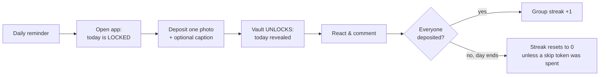
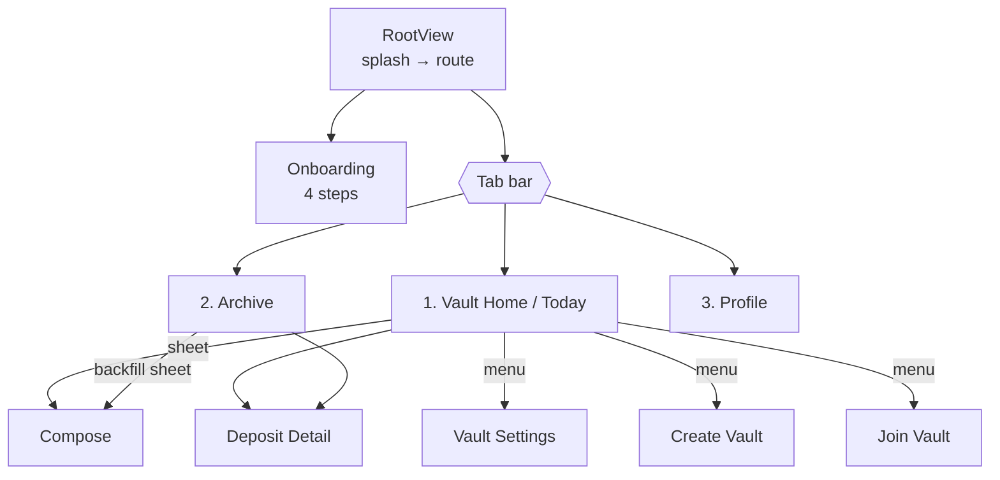
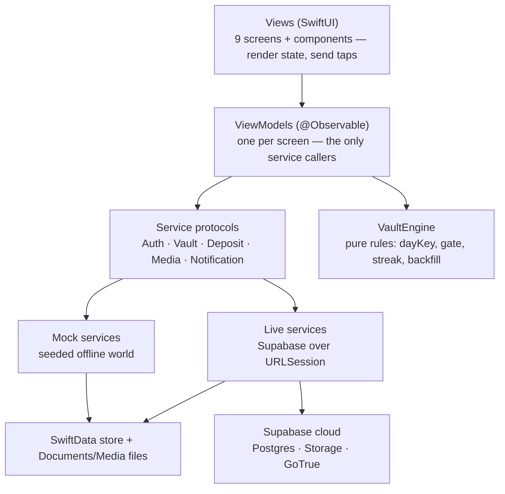
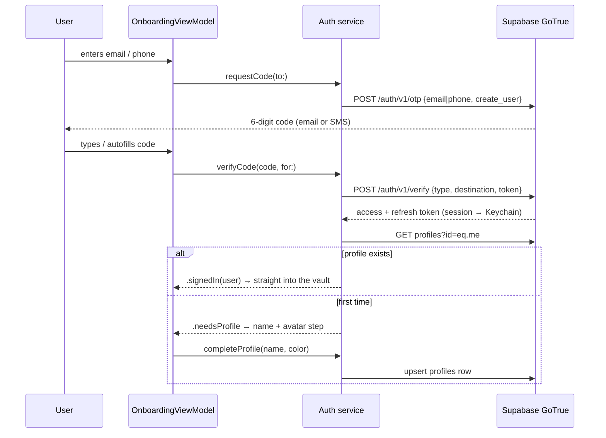
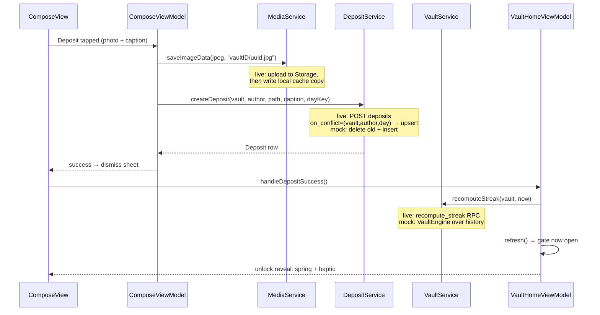

# Vault — The Complete Guide

> A private, daily photo ritual for small groups. One photo per person per day. Today stays **locked** until you contribute yours. The streak belongs to the **group**. Over time, the vault becomes the group's permanent collective archive — the opposite of Instagram: private, permanent, small, daily.

This document is the single place to understand everything: the product, the rules, the architecture, the data, the auth system, the backend, and how it all connects. Companion docs: [README.md](README.md) (quick start + file map), [DEPLOYMENT.md](DEPLOYMENT.md) (go-live runbook), [supabase/schema.sql](supabase/schema.sql) (the entire backend in one file).

| Fact | Value |
|---|---|
| Platform | iOS 17.0+, SwiftUI only, Xcode 16 |
| Persistence | SwiftData on-device; Supabase Postgres in live mode |
| Dependencies | **Zero** third-party packages — Apple frameworks + raw `URLSession` |
| State | `@Observable` (Observation framework), no Combine |
| Backends | Mock (seeded offline demo) and Live (Supabase) behind identical protocols |
| Auth | Sign in with Apple, email + SMS 6-digit codes (mock code: `123456`) |
| Design | Monochrome "gallery print": paper white, ink black, serif display type |
| Tests | `VaultEngine` covered by deterministic XCTests (⌘U) |

---

## Table of contents

1. [What Vault is](#1-what-vault-is)
2. [The rules](#2-the-rules)
3. [The nine screens](#3-the-nine-screens)
4. [Architecture](#4-architecture)
5. [Two backends, one app](#5-two-backends-one-app)
6. [Data model](#6-data-model)
7. [Authentication](#7-authentication)
8. [Life of a deposit](#8-life-of-a-deposit)
9. [Sync model](#9-sync-model)
10. [The Supabase backend](#10-the-supabase-backend)
11. [Design system](#11-design-system)
12. [The mock world & debug tools](#12-the-mock-world--debug-tools)
13. [Testing & verification](#13-testing--verification)
14. [File map](#14-file-map)
15. [Project configuration](#15-project-configuration)
16. [Known limitations & roadmap](#16-known-limitations--roadmap)

---

## 1. What Vault is

A vault is a private group of 2–8 people — a family, a couple, a friend group. Every member deposits exactly one photo per day. The hook is the **reciprocity gate**: you can see *that* your people posted today (frosted cards with their names), but not *what* — until you deposit your own. Past days are always open, like a shared album the group binds one page at a time.

The daily loop:



Design intent: under 15 seconds from notification to deposited. No infinite scroll, no public anything, no individual clout — the streak is shared, so accountability is social.

## 2. The rules

All rules live in one pure-logic file, [`VaultEngine.swift`](Vault/Engine/VaultEngine.swift) — no UI, no database, no wall clock. Everything is injected (calendar, `now`), which is why it's fully unit-tested and why the debug "advance mock day" feature works.

**dayKey.** Every deposit is stamped with the calendar day in the device's timezone, formatted `"yyyy-MM-dd"`. Lexicographic order equals chronological order. A photo at 23:59 belongs to that day; 00:01 starts a new locked day.

**One per day.** One deposit per member per vault per dayKey. A second deposit the same day *replaces* the first (locally: delete-then-insert; server: an upsert on the unique constraint, atomically, keeping the same row id).

**The reciprocity gate.** Today is unlocked for you ⟺ a deposit exists with your author id and today's dayKey in this vault. Nothing else opens it — not others' deposits, not yesterday's deposit. While locked, today's cards show the author's name and avatar over a frosted stand-in; the actual image bytes are deliberately never loaded. The gate only ever applies to *today*.

**The group streak.** A day *counts* when every current member either deposited or spent a **skip token** (each member starts with 2). The count is the number of consecutive counting days, walking backward from today — or from yesterday if today isn't complete yet, because an in-progress day must never break the streak. The first incomplete *ended* day stops the walk.

Worked example (the seeded world, streak = 6):

| Day | −8 | −7 | −6 … −1 | today |
|---|---|---|---|---|
| Everyone in? | ✅ | ❌ Maya missed, no token | ✅ ×6 | 3 of 4 (you haven't posted) |
| Streak | — | reset to 0 | 1…6 | still 6 — today is in progress |

A subtle consequence, verified by test: if yesterday broke the streak but *today* is already complete, the streak is 1 — a new chain starts immediately.

**Backfill.** A past day can receive a deposit within 48 hours of that day's start — in practice, yesterday. The Archive tab surfaces this as "Add to yesterday". In this MVP a backfill does not *specially* repair streaks, but since streaks are recomputed over full history, a backfilled day is naturally seen on the next recompute (documented in `testBackfillDoesNotRepairBrokenStreak`).

**Invite codes.** 6 characters from `ABCDEFGHJKMNPQRSTUVWXYZ23456789` — ambiguous glyphs (0/O, 1/I/L) excluded. Server-generated and uniqueness-checked in live mode. The seeded vault's code is `CREW42`.

**Captions.** Optional, hard-capped at 80 characters (enforced in the UI field, the engine sanitizer, and the database constraint).

## 3. The nine screens



| Screen | What it does |
|---|---|
| **Onboarding** | Three concept cards → sign-in method (Apple / email / phone) → 6-digit code → profile (name + avatar ink). Returning accounts skip the profile step. |
| **Vault Home (Today)** | The main screen. Serif vault name, member avatar stack, streak badge. LOCKED: frosted 2-column grid + "Add today's memory". UNLOCKED: vertical feed of today's cards, "waiting on…" row, replace-photo action. Distinct empty state when nobody has posted. |
| **Compose** (sheet) | Photo picker opens immediately (camera button routes here too — single ingest path), caption with live 80-char counter, Deposit. Success plays the lock-opening spring + haptic. Also serves backfill with a "Deposit to yesterday" title. |
| **Archive** | Full history: month headers → day rows → horizontal photo strips. Today appears only once unlocked. Pull-to-refresh. Backfill banner when eligible. |
| **Deposit Detail** | Framed photo, caption, author, date, 5-emoji reaction row (tap toggles yours), comment thread + input bar. |
| **Create Vault** | Name + emoji picker → server-generated invite code → ShareLink with stub deep link `vault://join/{code}`. |
| **Join Vault** | 6-char code entry with error states (not found / already member / vault full). |
| **Vault Settings** | Members with roles + skip tokens, streak detail, daily reminder hour (schedules a real local notification in live builds), invite code with copy, leave vault (destructive, confirmed). |
| **Profile** | Name + avatar ink editing, sign out (confirmed), version — and in mock mode only, the DEBUG section. |

## 4. Architecture

MVVM plus a protocol-oriented service layer. The golden rule: **each layer only talks to the layer directly below it.** Views never touch services; services never touch views; the engine touches nothing.



Key decisions and why:

- **`AppDependencies` is the composition root** ([App/AppDependencies.swift](Vault/App/AppDependencies.swift)). Built once in `VaultApp.init`, injected via SwiftUI Environment. It owns the ModelContainer, the engine, the injectable clock (`AppDateProvider`), the observable `AppSession` (current user, active vault, readiness), `DebugSettings`, and all five services. `makeMock()` and `makeLive(config:)` are the only two wirings.
- **The engine is value-typed.** It consumes `DepositSnapshot` structs (id, vaultID, authorID, dayKey, createdAt) — never SwiftData models — plus an injected `Calendar` and explicit `now: Date`. That's what makes the math deterministic and testable.
- **View models are `@MainActor @Observable` classes**, created by their views via `@State` and handed `deps` from the environment. SwiftUI re-renders automatically when their properties change — no manual refresh plumbing.
- **Navigation** is a typed `Route` enum over per-tab `NavigationStack` paths, owned by an `@Observable AppRouter` ([App/AppRouter.swift](Vault/App/AppRouter.swift)). `@Model` classes are `Hashable` by identity, so models ride in the path directly.
- **Images are files, not database blobs.** Deposits store a path *relative to Documents* (the sandbox's absolute path changes between launches). `LocalDepositImage` resolves bytes through the media service asynchronously and reloads if the path changes.

## 5. Two backends, one app

The decision happens once, at launch, in `VaultApp.init`: if a `Vault/Vault/Supabase.plist` with real values is bundled, `AppDependencies.makeLive(config:)` wires Supabase; otherwise `makeMock()` wires the demo world. **No view or view model knows which mode it's in** — they program against the five protocols. (`deps.isLive` exists only to gate seeding and the DEBUG section.)

| Concern | Mock | Live |
|---|---|---|
| Accounts | Identity → local user map in UserDefaults; code always `123456`; first launch auto-signs-in seeded "You" | GoTrue: Apple id_token, email/SMS OTP; session in Keychain with auto-refresh |
| Vault CRUD | SwiftData inserts; invite lookup in-store | `create_vault` / `join_vault` RPCs (atomic code generation, 8-member cap) |
| Deposits | Delete-then-insert replacement | Upsert on `(vault_id, author_id, day_key)` unique constraint |
| Images | JPEG to `Documents/Media/` | Upload to Storage bucket `deposits` + same local file as cache |
| Streak | `VaultEngine.computeStreak` on-device | `recompute_streak` RPC — server is the single source of truth so all phones agree |
| Skips | In-memory `SkipLedger`, seeded | `skips` table + `spend_skip_token` RPC |
| Notifications | No-op | Real local daily reminder via `UNUserNotificationCenter` |
| Seeding / DEBUG | 30 days of history; debug tools visible | Disabled / hidden |

## 6. Data model

Six SwiftData `@Model` classes ([Models/SchemaModels.swift](Vault/Models/SchemaModels.swift)), mirrored one-to-one by Postgres tables in [schema.sql](supabase/schema.sql):

```mermaid
erDiagram
    USER ||--o{ MEMBERSHIP : "joins via"
    VAULT ||--o{ MEMBERSHIP : has
    VAULT ||--o{ DEPOSIT : holds
    USER ||--o{ DEPOSIT : authors
    DEPOSIT ||--o{ REACTION : receives
    DEPOSIT ||--o{ COMMENT : receives
    USER ||--o{ REACTION : gives
    USER ||--o{ COMMENT : writes

    USER {
        UUID id PK
        string displayName
        string avatarColorHex
        date joinedAt
    }
    VAULT {
        UUID id PK
        string name
        string emoji
        string inviteCode UK
        int notificationHour "default 19"
        int streakCount
        date lastStreakDate
    }
    MEMBERSHIP {
        UUID id PK
        enum role "keeper | member"
        int skipTokensRemaining "default 2"
        date joinedAt
    }
    DEPOSIT {
        UUID id PK
        string localImagePath "relative to Documents"
        string caption "max 80, optional"
        string dayKey "yyyy-MM-dd"
        date createdAt
    }
    REACTION {
        UUID id PK
        string emoji
    }
    COMMENT {
        UUID id PK
        string text
    }
```



Relationship notes: inverses are declared once, on the to-many side, with cascade deletes (deleting a vault removes its memberships and deposits; deleting a deposit removes its reactions and comments). The server adds what the client can't enforce: `unique (vault_id, author_id, day_key)` on deposits (same-day replacement), `unique (deposit_id, user_id, emoji)` on reactions (toggle semantics), `unique (user_id, vault_id)` on memberships, and check constraints on caption length, dayKey shape, and hour range.

## 7. Authentication

Three ways in, one account model. Email and phone send a **6-digit verification code**; Apple uses the native sheet. All resolve to a Supabase `auth.users` row; the app's `profiles` row (name + avatar) is created on first sign-in by the onboarding profile step.



Sign in with Apple specifics: the view model generates a random nonce, sends its SHA-256 to Apple ([Support/AppleSignInNonce.swift](Vault/Support/AppleSignInNonce.swift)), and the raw nonce + identity token go to GoTrue's `id_token` grant — replay-protected, no client secret needed. Apple provides the user's name **only on first authorization**; it's prefilled into the profile step.

Session lifecycle: tokens live in the **Keychain** ([KeychainStore.swift](Vault/Services/Live/KeychainStore.swift)), access tokens auto-refresh ~60s before expiry, a failed refresh surfaces as signed-out. Sign out hits `/logout`, clears the Keychain, and returns you to onboarding; signing back in with the same identity lands directly in your vault (no profile step). The mock mirrors the entire state machine — including resuming an interrupted sign-up at the profile step — with the fixed code `123456`.

UX details built in: SMS autofill (`.textContentType(.oneTimeCode)`), auto-submit on the sixth digit, paste support, resend with a 60-second cooldown (matching GoTrue's rate limit), E.164 phone normalization ("+1 (415) 555-0123" works), and a sign-out confirmation dialog.

## 8. Life of a deposit

The single most important flow — every layer participates:



The reveal is the signature interaction: a lock springs open over a paper-toned overlay, then the frosted grid becomes the real feed. Replacement (tapping "Replace today's photo") runs the identical path — the dayKey collision makes it an update instead of an insert.

## 9. Sync model

Pragmatic pull-based sync — right-sized for a daily-cadence app of ≤8 people:

- **When**: app launch, tab `.task`, app returning to foreground (`scenePhase`), pull-to-refresh, and after every mutation.
- **How**: live services fetch DTOs (PostgREST rows), then [`SupabaseStore`](Vault/Services/Live/SupabaseStore.swift) reconciles them into SwiftData — upsert by id, update fields in place, and **prune** local rows that vanished remotely (left members, replaced deposits, removed reactions). Views keep rendering the same SwiftData models they always did; reconciliation is the entire trick that kept the UI identical across backends.
- **Images**: cache-first. `Documents/Media/<vault>/<file>.jpg` is checked before a Storage download; your own uploads are written locally immediately so they render instantly.
- **Not yet**: Supabase Realtime (live updates without refresh) and APNs pushes — both are documented upgrades, not architecture changes.

## 10. The Supabase backend

Everything server-side lives in **one idempotent SQL file** ([supabase/schema.sql](supabase/schema.sql)) run once in the Supabase SQL editor. Three pillars:

**Tables** — `profiles`, `vaults`, `memberships`, `deposits`, `reactions`, `comments`, `skips`, with the constraints listed in §6 and indexes on the hot paths (`deposits(vault_id, day_key)`, `memberships(user_id)`).

**Row Level Security** — privacy *is* the product, so the database enforces it even against a malicious client (the anon key ships in the binary by design; RLS is the boundary):

| Table | You can read | You can write |
|---|---|---|
| profiles | yourself + anyone sharing a vault with you | only your own row |
| vaults | vaults you belong to | keeper updates settings; create/join via RPC only |
| memberships | co-members | delete your own (leave); insert via RPC only |
| deposits | your vaults' | only your own, only into your vaults, only within the 48h window |
| reactions / comments | wherever you can see the deposit | your own |
| storage objects | bucket `deposits`, gated by the vault-id path folder | members of that vault |

Helper functions (`is_vault_member`, `is_vault_keeper`, `shares_vault_with`, `can_see_deposit`) are `SECURITY DEFINER` — the standard way to avoid the memberships-policy-reads-memberships RLS recursion trap.

**RPCs** — logic that must be atomic or trusted runs in the database:

| Function | Purpose |
|---|---|
| `create_vault(name, emoji)` | Vault + keeper membership + unique invite code in one transaction |
| `join_vault(code)` | Validates the code, enforces the 8-member cap, inserts membership |
| `spend_skip_token(vault, user, day)` | Decrements tokens and records the skip atomically |
| `recompute_streak(vault, today)` | Walks full deposit+skip history — mirrors `VaultEngine` exactly; the server's answer is canonical so every phone agrees |

The Swift side talks to all of this through [`SupabaseClient`](Vault/Services/Live/SupabaseClient.swift) — a ~400-line, zero-dependency `URLSession` client for exactly the GoTrue/PostgREST/Storage surface Vault needs, with snake_case Codable mapping and ISO-8601 date handling.

## 11. Design system

Monochrome "gallery print," defined entirely in [Support/Theme.swift](Vault/Support/Theme.swift):

- **Canvas**: warm paper (`#FAFAF8`-ish) background; true-white cards lifted by 1px hairline borders + soft shadows (`.cardSurface()` is the reusable treatment).
- **Ink**: one near-black for text, buttons, badges, highlights. The only non-monochrome color is a muted brick red reserved for destructive actions and errors.
- **Type**: New York serif for display moments (vault name, onboarding titles, archive months — `Theme.displayFont`); SF for everything else; monospaced for codes.
- **Identity**: avatars use an 8-step ink ramp (`AvatarPalette`) so member colors stay strictly black-and-white. **Photos are the only color in the app** — by design, they read like prints in a gallery.
- **Signature motion**: the lock→unlock spring reveal with a heavy-impact-then-success haptic ([Support/Haptics.swift](Vault/Support/Haptics.swift)).
- The app icon (ink vault wheel on paper) is generated by [tools/generate_icon.swift](tools/generate_icon.swift) — vector-drawn, 1024×1024, opaque, App Store-compliant.

No red badges, no infinite scroll, no engagement tricks.

## 12. The mock world & debug tools

First launch (mock mode) builds a complete demo world ([Seeding/SeedDataService.swift](Vault/Seeding/SeedDataService.swift)):

- Vault **"The Crew" 🏔**, invite code `CREW42`, four members: You (keeper), Maya, Sam, Riley.
- 30 days of history with deliberate texture: misses at day −24 (Riley) and −7 (Maya) that reset the streak, a skip-token save at day −14 (Sam, who therefore has 1 token left), reactions and comments on yesterday. Net seeded streak: **6**.
- ~100 placeholder photos generated on-device (gradient + SF Symbol via `UIGraphicsImageRenderer`) — no bundled assets, no network.
- Today: Maya, Sam, and Riley have posted; **you haven't** — so the app opens straight into the LOCKED state and the core mechanic is visible within the first second.

Profile → DEBUG (mock only): **simulate "I haven't posted today"** (forces the gate shut), **advance mock day by 1** (shifts the injected clock — the streak math runs for real), **regenerate seed data** (full teardown + rebuild behind the splash screen). Sign out and walk the whole auth flow with code `123456`; a fresh sign-up gets an empty account that can join `CREW42`.

## 13. Testing & verification

- [`VaultTests/VaultEngineTests.swift`](VaultTests/VaultEngineTests.swift) — deterministic (calendar pinned to America/Los_Angeles, explicit dates): perfect-day increment, missing-member reset, incomplete-today preservation, skip-token preservation, same-day replacement, dayKey boundary (the 23:59/00:01 gate flip), the backfill window (yesterday ✓ / 2 days ✗ / today ✗ / future ✗), backfill-vs-streak behavior, gate semantics, caption sanitization, invite-code shape. Run with ⌘U.
- The engine logic has additionally been executed against every test scenario outside Xcode; the full non-UI stack (models, all ten service implementations, client, store, view models) type-checks against the real SDK frameworks.
- What only Xcode can verify: SwiftUI view compilation and the live wire formats against a real Supabase project (the runbook flags the likely friction points).

## 14. File map

```
Vault/
├── OVERVIEW.md                ← you are here
├── README.md                  Quick start, architecture summary, mock↔live swap table
├── DEPLOYMENT.md              Go-live runbook: Supabase setup, TestFlight, smoke test
├── Vault.xcodeproj            Xcode 16 project (synchronized folders, two targets)
├── supabase/
│   ├── schema.sql             Tables + RLS + storage policies + 4 RPCs (run once)
│   └── Supabase.example.plist Copy to Vault/Vault/Supabase.plist to go live
├── tools/generate_icon.swift  Renders the app icon (swift tools/generate_icon.swift out.png)
├── Vault/                     ── app target ──
│   ├── VaultApp.swift         @main: picks mock vs live, injects environment
│   ├── Vault.entitlements     Sign in with Apple capability
│   ├── PrivacyInfo.xcprivacy  Privacy manifest (required for App Store)
│   ├── App/                   AppDependencies (composition root), AppRouter
│   ├── Models/                SchemaModels.swift — the six @Model classes
│   ├── Engine/                VaultEngine.swift — all business rules, pure
│   ├── Services/              5 protocols + Mock implementations
│   │   └── Live/              SupabaseClient, SupabaseStore, DTOs, KeychainStore,
│   │                          BackendConfig, 5 Live implementations
│   ├── Seeding/               SeedDataService, PlaceholderImageGenerator
│   ├── ViewModels/            One @Observable class per screen
│   ├── Views/                 RootView + 9 screens in feature folders
│   ├── Components/            AvatarStack, DepositCards, StreakBadge, PrimaryButton,
│   │                          CaptionTextField, CodeEntryField, EmptyVaultState
│   ├── Support/               Theme, Haptics, DateProviding, AppleSignInNonce
│   └── Assets.xcassets        App icon + ink accent color
└── VaultTests/                VaultEngineTests.swift
```

## 15. Project configuration

- **Modes**: no `Supabase.plist` → mock; filled-in plist → live. The plist is gitignored; the anon key it holds is publishable (RLS is the security boundary).
- **Entitlements**: `Vault.entitlements` carries Sign in with Apple; wired via `CODE_SIGN_ENTITLEMENTS`. Registering the capability needs the paid Apple Developer Program.
- **App Store readiness**: 1024px opaque icon, privacy manifest (no tracking; photos/name/user-id collected for app functionality only), `ITSAppUsesNonExemptEncryption = NO`.
- **Build**: `GENERATE_INFOPLIST_FILE = YES` (no Info.plist to maintain), iOS 17.0 target, Swift 5 language mode, portrait-first iPhone, synchronized folder groups (drop a file in, it's in the build).

## 16. Known limitations & roadmap

Honest edges, in rough priority order:

1. **Identity linking** — email X and phone Y create two different accounts today. GoTrue identity linking unifies them.
2. **Timezones** — dayKey is device-local and the server trusts the client's "today" (clamped to a 48h window). Same-timezone groups: fine. Split groups need a vault "home timezone".
3. **Realtime** — others' deposits appear on foreground/pull-to-refresh; Supabase Realtime subscriptions would make them instant.
4. **Push notifications** — the daily reminder is local-only; server-driven APNs ("everyone else has deposited!") needs an APNs key + an edge function.
5. **Storage orphans** — replacing a photo leaves the old Storage object behind (harmless at this scale; a scheduled cleanup function fixes it).
6. **Email deliverability** — Supabase's built-in mailer is rate-limited to a few messages/hour; configure SMTP before group testing. SMS requires a paid Twilio setup.
7. **Home-screen widget** — planned post-MVP as a `Widgets/` extension target sharing the store via an app group.
8. **Keeper succession** — if the keeper leaves, no one is promoted (server-side reassignment is a TODO in the leave flow).
